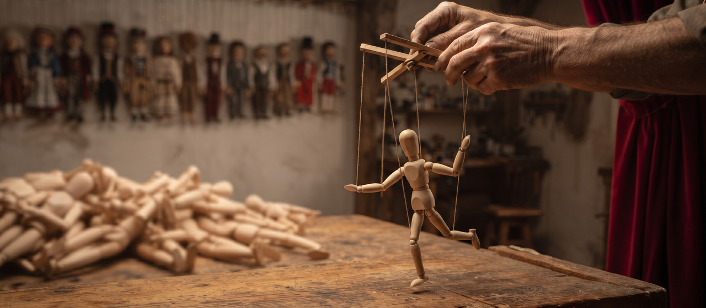
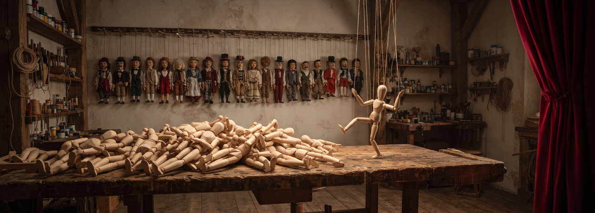
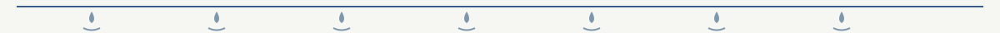
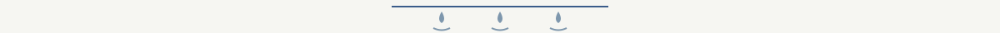

# codeintel-Insecure-Deserialization-Checker

Detects potential insecure deserialization vulnerabilities by analyzing code for usage of pickle or similar libraries without proper input validation. Focuses on identifying deserialization calls on untrusted data. - Focused on Tools for static code analysis, vulnerability scanning, and code quality assurance

## Install
`git clone https://github.com/ShadowStrikeHQ/codeintel-insecure-deserialization-checker`

> **Diary margin note, wrong name on the address.** The clone line above names ShadowStrikeHQ rather than ShadowGuard-AI. It is kept as printed and flagged here, not corrected in the display. The repository LICENSE file carries the MIT License, while the closing line of this README reads Copyright (c) ShadowStrikeHQ; both facts stand as printed.

## Usage
`./codeintel-insecure-deserialization-checker [params]`

> **Diary margin note, the path argument is missing.** The usage line above is a placeholder that the parser does not accept. The line the parser accepts is `python3 main.py FILEPATH [-v] [-e PATH ...] [-o FILE]`, where filepath is a required argument naming one Python file or one directory, and it appears in no parameter entry below. Its restoration lives on the website only, marked there, so the gap remains visible where it was found.

## Parameters
- `-h`: Show help message and exit
- `-v`: No description provided
- `-e`: List of files or directories to exclude from analysis.
- `-o`: Path to output file for scan results.  If omitted, results will be printed to the console.

> **Diary margin note, exclusion works by plain prefix.** The code tests exclusions as simple text prefixes, not checked against a path boundary, so excluding a path called data also excludes a neighbouring path called database. This caution is recorded here because the README entry above does not mention it.

## License
Copyright (c) ShadowStrikeHQ

> **Diary margin note, wrong name on the address.** The copyright line above names ShadowStrikeHQ rather than ShadowGuard-AI. It is kept as printed and flagged here. The repository LICENSE file carries the MIT License.
